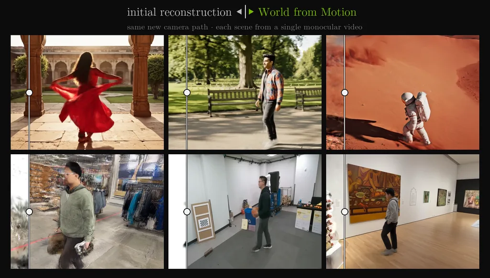

<div align="center">

# World from Motion
### Generative Dynamic Gaussian Reconstruction from Monocular Video

**NeurIPS 2026**

[Liyuan Zhu](https://www.zhuliyuan.net/)<sup>1,2</sup> ·
[Shengyu Huang](https://shengyuh.github.io/)<sup>2</sup> ·
[Amrita Mazumdar](https://amritamaz.net/)<sup>2</sup> ·
[Tianye Li](https://tianyeli.github.io/)<sup>2</sup> ·
[Zan Gojcic](https://zgojcic.github.io/)<sup>2</sup><br>
[Gordon Wetzstein](https://web.stanford.edu/~gordonwz/)<sup>1</sup> ·
[Iro Armeni](https://ir0.github.io/)<sup>1</sup> ·
[Shalini De Mello](https://research.nvidia.com/person/shalini-de-mello)<sup>2</sup> ·
[Alex Trevithick](https://alextrevithick.com/)<sup>2</sup>

<sup>1</sup>Stanford University &nbsp; <sup>2</sup>NVIDIA

[**Project page**](https://research.nvidia.com/labs/amri/projects/world-from-motion/) ·
[**Paper**](https://arxiv.org/abs/2607.01202) ·
[**Teaser**](https://research.nvidia.com/labs/amri/projects/world-from-motion/videos_compressed/video_grids/hero_teaser.mp4) ·
[**Interactive viewer**](https://research.nvidia.com/labs/amri/projects/world-from-motion/interactive_3dgs/)

<a href="https://research.nvidia.com/labs/amri/projects/world-from-motion/"></a>

</div>

World from Motion turns a monocular video into a dynamic 3D Gaussian scene that
can be rendered from new viewpoints. A video model refines views rendered from
an initial reconstruction, then those generated views are distilled back into
the scene. The core video pipeline combines MoSca reconstruction with DiffSynth video generation.

## Getting started

1. Build the environment using the [installation guide](docs/INSTALL.md).
2. Prepare the [model bundle](docs/ASSETS.md).
3. Reconstruct your video with the [usage guide](docs/USAGE.md).
4. Reproduce **Ours (sample)** and **Ours (distill)** on DyCheck using
   [REPRODUCTION.md](REPRODUCTION.md), including the benchmark-specific setup,
   commands and reference numbers.

Model weights are distributed separately. The DyCheck Table 1 checkpoint is on
Hugging Face at [`liyzzz/World-from-Motion`](https://huggingface.co/liyzzz/World-from-Motion),
and the released evaluation masks are at
[`liyzzz/World-from-Motion-DyCheck-Masks`](https://huggingface.co/datasets/liyzzz/World-from-Motion-DyCheck-Masks).
The download location for the video-pipeline model bundle will be added when it is published.

## Code structure

| Directory | Contents |
| --- | --- |
| `src/wfm/` | Video generation, camera controls and pipeline utilities |
| `docs/` | Installation, model setup and video usage |
| `scripts/` | Source-package checks |
| `config/` | Model and inference settings |
| `tests/` | Unit tests using synthetic inputs |
| `reproduce/` | DyCheck sampling, distillation, evaluation and pinned research backends |
| `vendor/` | Dependencies and their original licenses |

## Citation

```bibtex
@inproceedings{zhu2026worldfrommotion,
  title = {World from Motion: Generative Dynamic Gaussian Reconstruction from Monocular Video},
  author = {Liyuan Zhu and Shengyu Huang and Amrita Mazumdar and Tianye Li and Zan Gojcic and Gordon Wetzstein and Iro Armeni and Shalini De Mello and Alex Trevithick},
  booktitle = {Advances in Neural Information Processing Systems (NeurIPS)},
  year = {2026}
}
```

## Acknowledgements and license

The original World from Motion code and the WfM step-12500 checkpoint are
licensed under [Apache-2.0](LICENSE). See [NOTICE](NOTICE) for copyright and
model attribution, and [model setup](docs/ASSETS.md) for checkpoint packaging.

This implementation builds on MoSca, DiffSynth-Studio and the other components
listed in [THIRD_PARTY_NOTICES.md](THIRD_PARTY_NOTICES.md). Bundled third-party
code and separately obtained models retain their respective licenses.
